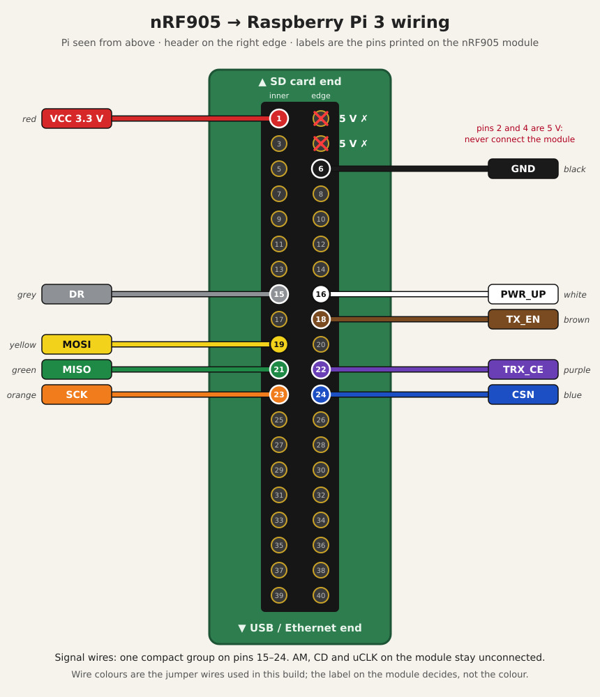
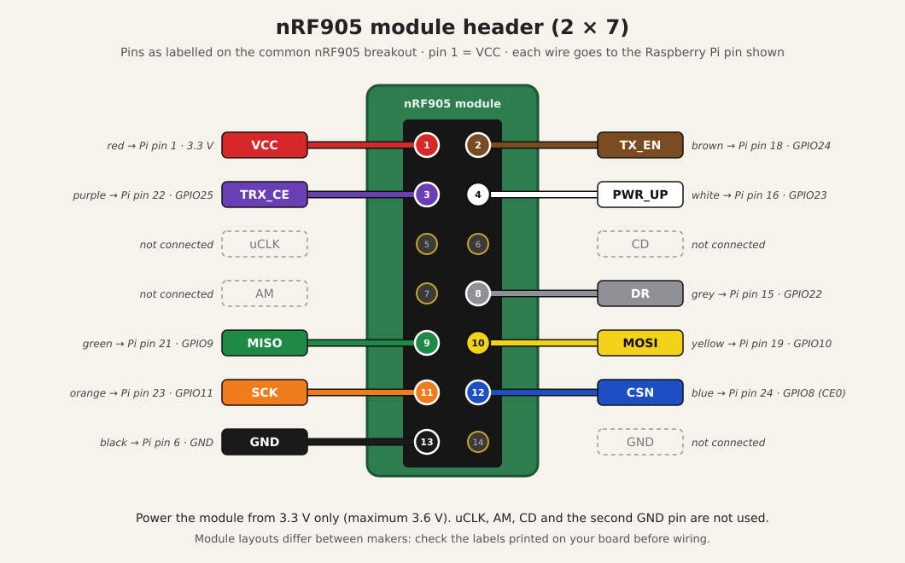

# Zehnder ComfoFan control from a Raspberry Pi

Control a Zehnder ComfoFan Silent ventilation unit over its 868 MHz RF link,
using a Raspberry Pi and an nRF905 radio module. The Pi pairs with the fan as
an extra remote control and can then read and set the fan speed.

Tested with a Raspberry Pi 3 Model B (Raspberry Pi OS 13 "trixie") and a
ComfoFan Silent.

## Hardware

- Raspberry Pi with the 40-pin header and SPI enabled (`dtparam=spi=on` in
  `/boot/firmware/config.txt`, or `sudo raspi-config` > Interface Options > SPI)
- nRF905 module (868 MHz, 16 MHz crystal) with antenna
- 10 female-to-female jumper wires

## Wiring

The module runs on **3.3 V only** (maximum 3.6 V). Never connect it to the
Pi's 5 V pins (2 and 4).

| nRF905 pin | Wire colour | Pi physical pin | Pi function     |
|------------|-------------|-----------------|-----------------|
| VCC        | red         | 1               | 3.3 V           |
| GND        | black       | 6               | Ground          |
| DR         | grey        | 15              | GPIO22          |
| PWR_UP     | white       | 16              | GPIO23          |
| TX_EN      | brown       | 18              | GPIO24          |
| MOSI       | yellow      | 19              | GPIO10 (MOSI)   |
| MISO       | green       | 21              | GPIO9 (MISO)    |
| TRX_CE     | purple      | 22              | GPIO25          |
| SCK        | orange      | 23              | GPIO11 (SCLK)   |
| CSN        | blue        | 24              | GPIO8 (CE0)     |

uCLK, AM, CD and the second GND pin on the module are not connected. The wire
colours are the ones used in this build; what counts is the label printed on
the module.

Raspberry Pi side:



nRF905 module side:



## Software

`zehnder.py` needs Python 3 with `spidev` and `lgpio`, both part of Raspberry
Pi OS. Your user must be in the `spi` and `gpio` groups.

```
./zehnder.py info                 check that the radio answers
./zehnder.py listen               print frames on the link address (receive only)
./zehnder.py listen -n            print frames on the paired network (receive only)
./zehnder.py pair                 pair with the fan
./zehnder.py status               ask the fan for its current settings
./zehnder.py speed low|medium|high|max|auto
./zehnder.py timer high 30        run a speed for a number of minutes
```

Add `-v` before the command to see every frame sent and received, for example
`./zehnder.py -v speed high`.

### Pairing

The fan unit only accepts new remotes during the first 10 minutes after it is
powered on.

1. Unplug the fan unit for a few seconds and plug it back in.
2. Run `./zehnder.py pair`.

The pairing (network address and device IDs) is saved in `zehnder.json` next
to the script. That file is specific to one fan and is not kept in git.

## Troubleshooting

`./zehnder.py info` reads the radio's configuration register. A freshly
powered nRF905 answers `6C 00 44 20 20 E7 E7 E7 E7 E7`. All `00` or all `FF`
means the module is not answering: check power, MISO, CSN and that the wires
are on the pins from the table, counted from the SD card end of the header.

`./zehnder.py listen` shows nothing until a device transmits on the address it
listens on. Power-cycling the fan unit makes it broadcast "open for linking"
once a second on the link address.

## Protocol

- 868.4 MHz (nRF905 channel 118, 868 MHz band), GFSK, CRC-16
- 4-byte address, 16-byte payload
- Link address used for pairing: `A5 5A 5A A5`
- Payload: receiver type, receiver ID, sender type, sender ID, time-to-live,
  command, parameter count, up to 9 parameters

The protocol was reverse engineered by others; this tool follows their work:

- [eelcohn/ZehnderComfoair](https://github.com/eelcohn/ZehnderComfoair): protocol documentation
- [Sanderhuisman/ESPHome-Zehnder-RF](https://github.com/Sanderhuisman/ESPHome-Zehnder-RF): ESPHome implementation
